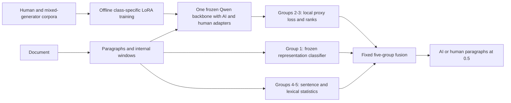

**English** | [简体中文](README.zh-CN.md)

# FiveTrace V2

### Train on generator corpora. Detect with one local Qwen backbone.

[Method](docs/METHOD.md) · [Full results](docs/RESULTS.md) · [Protocol](docs/PROTOCOL.md)


**A detector that learns from a generator's text rather than requiring its weights or inference API.** FiveTrace V2 uses one frozen Qwen3-1.7B-Base with AI/human LoRA adapters, a representation classifier, and sentence/lexical statistics.

On **499 topic-matched LLaDA-generated and human academic abstract pairs**, the frozen V2 detector reaches **0.9920 Macro-F1**, **99.20% AI recall**, and **0.80% human false positives** at the fixed 0.5 cutoff. The diffusion generator is absent from the audited fitting manifest. This is one external condition, not a universal accuracy or state-of-the-art claim.

## The core idea: corpus-based proxy likelihood and ranks

For evidence groups **2 and 3**, collect labelled generator outputs and human writing, then train small class-conditional adapters on a local Qwen reference model. At detection time:

- **No target-generator model weights are needed.**
- **No GPT/Claude/other target-generator inference calls are made.**
- One Qwen backbone supplies Base, AI-adapter and human-adapter likelihood/rank statistics.
- The AI adapter learns a **mixture of generators**; the human adapter learns human text. This is not an exact clone of each generator's distribution.

This reduces the required target-model dependencies and avoids per-document target API charges. It still requires local Qwen computation under **three reference variants**, sliding contexts for long inputs, exact vocabulary-wide ranks, tokenization and fusion. Corpus collection, adapter training and local inference have costs. We have not measured a percentage speedup or dollar saving against proprietary models.



The design centers on compact corpus-trained references, class-conditional differences and five-group fusion. Generator coverage comes from the training corpora; the deployed scoring backbone stays local.

## External results

The table reports **Macro-F1** on each matched condition. V2 uses the same full-text policy throughout. Context-limited XLM-R and the published MAGE deployment recipe are labelled explicitly; the common full-text control and raw MAGE context-limit scores are also in the [complete results](docs/RESULTS.md).

| Matched condition | Topic families | **FiveTrace V2** | XLM-R · original first 512 tokens | MAGE · author recipe |
|---|---:|---:|---:|---:|
| LLaDA abstract generation | 499 | **0.9920** | 0.8778 | 0.9336 |
| LLaDA rephrasing | 497 | 0.7068 | **0.8448** | 0.6567 |
| LLaMA abstract generation | 499 | **0.9960** | 0.9417 | 0.9316 |

**Performance changes substantially with the task.** The stronger abstract-generation result does not remove the rephrasing gap. On the additional AI-only diffusion set, V2 recall ranges from **47% to 98%** across the seven published model/length strata; that collection has no human controls, so no F1/FPR is invented.

Selected other sources, V2 at 0.5:

| Source / condition | Human / AI inputs | Human FPR | AI recall |
|---|---:|---:|---:|
| C-ReD source-familiar holdout | 804 / 1099 | 0.37% | 99.55% |
| HC3 source-familiar holdout | 382 / 382 | 0.26% | 100.00% |
| M4 Chinese QA | 100 / 200 | 1.00% | 95.00% |
| STORAL normal stories | 100 / 100 | 0% | 100% |
| TextSight English | 643 / 48 | 3.11% | 83.33% |
| ToolBenchmarks English | 150 / 600 | 0% | **16.83%** |
| Data-Prep English QA · AI only | 0 / 1168 | — | **13.18%** |

The last two rows are retained because short/factual answers and new sources remain difficult. V2 is **Chinese-first**; English results are experimental transfer, not bilingual fine-tuning. The previous five-epoch V3 DetectRL-X score does not belong to V2 and is not advertised here.

## Run locally

This repository ships **code, documentation and aggregate results**. It ships **no datasets, real source examples, individual predictions, caches, adapters or Base weights**. Training downloads pinned public upstream resources into ignored runtime directories.

```bash
python -m venv .venv
# Activate .venv, then install a CUDA-compatible PyTorch build.
pip install -r requirements.txt
python prepare_sources.py
python train.py all
python detect.py your_document.txt --output local_report.json
python evaluate.py your_test.jsonl --output aggregate_metrics.json
python -m unittest discover -s tests -v
```

`evaluate.py` accepts local JSONL with `text` and integer `label` (0 human, 1 AI); it writes aggregates only and separately counts inputs below 100 nonspace characters. No text is uploaded. Use `--artifact-dir` to select a compatible local detector. `FIVETRACE_HOME` optionally selects the local runtime root for models, data and artifacts.

The measured LoRA run used an **RTX 5060 Laptop GPU (8 GB)**. Each adapter has **1,605,632 trainable parameters**; one epoch used **3,000 training units per branch** and 160 development units. Both branches together took **16.2 minutes**, with about **4.18 GiB peak allocated CUDA memory during adapter training**. Feature extraction, fitting and evaluation add runtime; this is not an end-to-end training-time or inference-memory claim. [Measured resource aggregates](results/training.json).

The public trainer replays the historically selected full V2 LoRA architecture and its fitted-head/fusion recipe; it reports the current fixed 0.5 operating point. It does not reproduce an architecture search or silently train the five-epoch V3 recipe. See [training and test isolation](docs/PROTOCOL.md).

## Five evidence groups

| Group | Evidence | Implementation |
|---|---|---|
| 1 | Overall textual representation | Logistic head on frozen Base representations |
| 2 | Local-reference predictability | Base/AI/human causal-LM loss and branch differences |
| 3 | Local-reference token preference | Exact full-vocabulary midrank statistics and branch differences |
| 4 | Sentence-length variation | Mean, standard deviation and related length statistics |
| 5 | Lexical usage | Repetition, distribution and pronoun statistics |

Windows are weighted into paragraph scores, then the user-facing **AI ratio counts AI-labelled detection paragraphs**. Long internal windows do not receive extra votes. The benchmark document score instead uses character-weighted probabilities; neither number establishes an author's identity or the actual amount of AI assistance.

## Boundaries and reproducibility

- We freeze weights and the 0.5 cutoff before external scoring. Test labels are not used to refit or select a new threshold.
- Fit/development family checks exclude known overlap. This does not prove semantic or Base-pretraining decontamination. MAGE's complete training exposure is not verified.
- Historical test sources have already influenced research; new-source results become exposed regression checks after publication.
- The source has a misindexed LLaMA rephrasing file. It is excluded from matched primary comparisons, not guessed into alignment.
- Mixed/edited text, long context, short answers and new generators can change performance. Adding a generator corpus requires retraining and independent validation; arbitrary unseen generators are not guaranteed.
- Published confidence intervals and source-family counts are in [aggregate JSON](results/external_v2.json); there is no independent-author count obtained by summing reused controls.
- We implement no telemetry or uploading. Third-party packages retain their own behavior. [Privacy boundary](docs/PRIVACY.md).

## Credits

Code is MIT-licensed; upstream corpora and models retain their own licenses and are not redistributed.

- [Qwen3-1.7B-Base](https://huggingface.co/Qwen/Qwen3-1.7B-Base).
- [C-ReD](https://github.com/HeraldofLight/C-ReD), [HC3-Chinese](https://huggingface.co/datasets/Hello-SimpleAI/HC3-Chinese), [NLPCC/CUDRT](https://github.com/NLP2CT/NLPCC-2026-Task6-Detection).
- [Can You Detect the Difference?](https://arxiv.org/abs/2507.10475) and [additional diffusion outputs](https://huggingface.co/datasets/paoche11/diffusion-generated-text).
- [Official DetectRL-X XLM-R](https://huggingface.co/WUJUNCHAO/DetectRL-X-XLM-RoBERTa-Detector-All), [MAGE](https://huggingface.co/yaful/MAGE) and its [public deployment recipe](https://github.com/yafuly/MAGE).

Please cite the upstream sources alongside this implementation. Reproducibility reports and careful new-domain evaluations are welcome.
