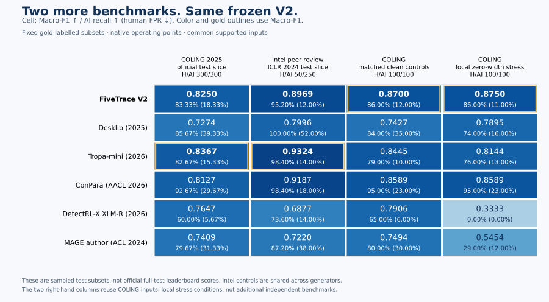
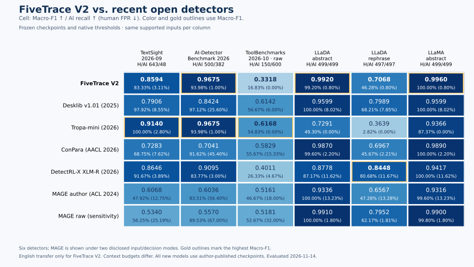
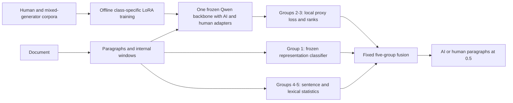

**English** | [简体中文](README.zh-CN.md)

# FiveTrace V2

### Five evidence groups. One local Qwen. Zero target-model API calls.

[Method](docs/METHOD.md) · [Recent comparisons](docs/RECENT_COMPARISON.md) · [Full results](docs/RESULTS.md) · [Protocol](docs/PROTOCOL.md)


**A detector that learns from a generator's text rather than requiring its weights or inference API.** FiveTrace V2 uses one frozen Qwen3-1.7B-Base with AI/human LoRA adapters, a representation classifier, and sentence/lexical statistics.

On **499 topic-matched LLaDA-generated and human academic abstract pairs**, the frozen V2 detector reaches **0.9920 Macro-F1**, **99.20% AI recall**, and **0.80% human false positives** at the fixed 0.5 cutoff. The diffusion generator is absent from the audited fitting manifest. This is one external condition, not a universal accuracy or state-of-the-art claim.

| Five fused evidence groups | One local 1.7B backbone | Zero target-generator API calls |
|---|---|---|
| Representation + loss + rank + sentence + lexical signals | Base + AI/human LoRAs | Corpus-based coverage without deploying the original generator |

## Chinese regression: ahead of official XLM-R in all 7 binary-label conditions

**Five Chinese sources, seven binary-label conditions**, compared with the **official DetectRL-X XLM-R (2026)**. V2 has higher Macro-F1 under both XLM-R's first-512-token and shared full-text policies. The first three rows are V2 training-source holdouts: these are source-familiar/transfer regression checks, **not a DetectRL-X official-test ranking**. Mixed/attacked conditions are labelled separately; human controls are reused.

Each cell shows **Macro-F1 ↑** on the first line and **AI recall ↑ (human FPR ↓)** on the second. Bold scores mark column-highest Macro-F1 only.

Macro-F1 averages the human-class and AI-class F1 scores. AI recall uses AI inputs as its denominator; human FPR is the fraction of human inputs incorrectly labelled AI.

| Source / condition | Human / AI | **FiveTrace V2** | XLM-R · first512 | XLM-R · shared fulltext |
|---|---:|---:|---:|---:|
| C-ReD · source-familiar holdout | 804/1099 | **0.9957**<br>99.55% (0.37%) | 0.9052<br>98.64% (19.40%) | 0.9052<br>98.64% (19.40%) |
| HC3 · source-familiar holdout | 382/382 | **0.9987**<br>100.00% (0.26%) | 0.7496<br>60.47% (9.42%) | 0.7496<br>60.47% (9.42%) |
| CUDRT · source-familiar holdout | 104/106 | **0.8158**<br>67.92% (3.85%) | 0.7164<br>55.66% (10.58%) | 0.7164<br>55.66% (10.58%) |
| M4 · Chinese QA | 100/200 | **0.9596**<br>95.00% (1.00%) | 0.6226<br>43.50% (0.00%) | 0.6052<br>41.00% (0.00%) |
| STORAL · unaltered | 100/100 | **1.0000**<br>100.00% (0.00%) | 0.8519<br>100.00% (29.00%) | 0.8519<br>100.00% (29.00%) |
| STORAL · mixed | 100/100 | **0.9700**<br>94.00% (0.00%) | 0.7545<br>80.00% (29.00%) | 0.7789<br>85.00% (29.00%) |
| STORAL · robustness | 353/500 | **0.9844**<br>97.80% (0.57%) | 0.7956<br>83.40% (24.36%) | 0.7866<br>81.80% (24.36%) |

[False positives, recall and full source details](docs/RESULTS.md).

## Two additional standard benchmarks

Beyond the earlier sources, we added the **COLING 2025 GenAI Task 1 official English test** and the **Intel AI Peer Review Detection Benchmark ICLR2024 test**. Sources, sampling, checkpoints and thresholds were fixed before prediction: **300 official human-class negatives + 300 machine-class labels**, and **50 human reviews matched to 50 papers with 50 reviews from each of 5 generators**. These are fixed subsets, **not full official leaderboard scores**.

Each cell shows **Macro-F1 ↑** on the first line and **AI recall ↑ (human FPR ↓)** on the second. Bold scores mark column-highest Macro-F1 only.

| Detector | COLING 2025 · official-test slice | Intel · peer-review test slice |
|---|---:|---:|
| **FiveTrace V2** | 0.8250<br>83.33% (18.33%) | 0.8969<br>95.20% (12.00%) |
| Desklib (2025) | 0.7274<br>85.67% (39.33%) | 0.7996<br>100.00% (52.00%) |
| Tropa-mini (2026) | **0.8367**<br>82.67% (15.33%) | **0.9324**<br>98.40% (14.00%) |
| ConPara (AACL 2026) | 0.8127<br>92.67% (29.67%) | 0.9187<br>98.40% (18.00%) |
| DetectRL-X XLM-R (2026) | 0.7647<br>60.00% (5.67%) | 0.6877<br>73.60% (14.00%) |
| MAGE author (ACL 2024) | 0.7409<br>79.67% (31.33%) | 0.7220<br>87.20% (38.00%) |

**COLING label semantics (post-hoc audit):** 75 of the 300 official human-class negatives are MixSet `gpt4_humanize`/`2llama_humanize` texts. The [MixSet authors](https://llm-coauthor.github.io/) describe humanize as editing machine-generated text. Consequently, human FPR in this column means **official-negative-class FPR**, not exclusively false accusations on purely human writing. This applies to every detector; all 600 original labels/inputs and published scores are retained.

**At the frozen native operating points, V2 has higher Macro-F1 than Desklib, official XLM-R and MAGE on both slices.** Tropa-mini has higher point estimates; paired intervals for V2 vs. Tropa/ConPara cross zero, so these samples do not establish a statistical separation.



Columns use common supported inputs across all 6 detectors; Intel retains complete paper pairs. COLING includes official mixed/edited tasks with their original labels. The [full report](docs/STANDARD_BENCHMARKS.md) separates source/tasks and generators. The two right-hand columns reuse the same texts as clean/zero-width stress conditions, **not extra independent benchmarks**. Known fit/prior-test overlap checks, source familiarity and limits are disclosed. No new test data was used for fitting or threshold calibration.

## Measured against recent open detectors

We added author-published **Desklib (2025), Tropa-mini (2026), and DeBERTa-ConPara (AACL-IJCNLP 2026)**, each scored on all **6,861 eligible public English inputs**. Alongside the official DetectRL-X XLM-R and MAGE, we compare **6 detectors** on the common supported inputs within each group; the MAGE author recipe exceeds its context limit on 6 older-source inputs. V2 was not retrained, and no thresholds were fitted to these test labels.



First, three different sources: **643/48, 500/382, and 150/600 human/AI inputs** respectively. Every detector uses the same inputs within a column; sources have different distributions.

Each cell shows **Macro-F1 ↑** on the first line and **AI recall ↑ (human FPR ↓)** on the second. Bold scores mark column-highest Macro-F1 only.

| Detector / release | TextSight | AI-Detector-Benchmark | ToolBenchmarks · raw |
|---|---:|---:|---:|
| **FiveTrace V2** | 0.8594<br>83.33% (3.11%) | **0.9675**<br>93.98% (1.00%) | 0.3318<br>16.83% (0.00%) |
| Desklib v1.01 · 2025 | 0.7906<br>97.92% (8.55%) | 0.8424<br>97.12% (25.60%) | 0.6142<br>56.67% (6.00%) |
| Tropa-mini · 2026 | **0.9140**<br>100.00% (2.80%) | **0.9675**<br>93.98% (1.00%) | **0.6168**<br>54.83% (0.00%) |
| DeBERTa-ConPara · AACL 2026 | 0.7283<br>68.75% (7.62%) | 0.7041<br>91.62% (45.40%) | 0.5829<br>55.67% (15.33%) |
| DetectRL-X XLM-R · 2026 | 0.8646<br>91.67% (3.89%) | 0.9095<br>83.77% (3.00%) | 0.4011<br>26.33% (4.67%) |
| MAGE · ACL 2024 · author | 0.6068<br>47.92% (12.75%) | 0.6036<br>83.51% (56.40%) | 0.5161<br>46.67% (18.00%) |
| MAGE · raw sensitivity† | 0.5340<br>56.25% (25.19%) | 0.5570<br>89.53% (67.00%) | 0.5181<br>52.67% (32.00%) |

Using the same cell format, the following are **three conditions of ONE academic-abstract benchmark**, not three independent benchmarks: **499/499, 497/497, and 499/499 human/AI inputs**. Shared controls are not independent authors to add together.

| Detector / release | LLaDA abstracts | LLaDA rephrasing | LLaMA abstracts |
|---|---:|---:|---:|
| **FiveTrace V2** | **0.9920**<br>99.20% (0.80%) | 0.7068<br>46.28% (0.80%) | **0.9960**<br>100.00% (0.80%) |
| Desklib v1.01 · 2025 | 0.9599<br>100.00% (8.02%) | 0.7989<br>68.21% (7.85%) | 0.9599<br>100.00% (8.02%) |
| Tropa-mini · 2026 | 0.7291<br>49.30% (0.00%) | 0.3639<br>2.82% (0.00%) | 0.9366<br>87.37% (0.00%) |
| DeBERTa-ConPara · AACL 2026 | 0.9870<br>99.60% (2.20%) | 0.6967<br>45.67% (2.21%) | 0.9890<br>100.00% (2.20%) |
| DetectRL-X XLM-R · 2026 | 0.8778<br>87.17% (11.62%) | **0.8448**<br>80.68% (11.67%) | 0.9417<br>100.00% (11.62%) |
| MAGE · ACL 2024 · author | 0.9336<br>100.00% (13.23%) | 0.6567<br>47.28% (13.28%) | 0.9316<br>99.60% (13.23%) |
| MAGE · raw sensitivity† | 0.9910<br>100.00% (1.80%) | 0.7952<br>62.17% (1.81%) | 0.9900<br>99.80% (1.80%) |

† Raw first-4096-token MAGE with softmax 0.5 is a **sensitivity control**, a second mode of the same detector rather than another competitor.

**Published/native operating points, not artificially matched false-positive rates:** V2 0.5; Desklib 0.5; Tropa 0.975591; ConPara uses its stored source-validation logit-margin threshold 2.942383; the MAGE author recipe has a separate raw-logit boundary. Context budgets also differ. The [full comparison](docs/RECENT_COMPARISON.md) reports observed FPR, recall, AUROC, confidence intervals, long-input policies and pinned revisions. Complete training exposure for new comparators is unknown; these texts are not proven unseen to every detector.

**V2 was primarily trained in Chinese; English is transfer evaluation.** Difficult rephrasing, short-answer and new-source conditions remain visible. This is not a claim of universal superiority on a complete leaderboard.

## The core idea: corpus-based proxy likelihood and ranks

For evidence groups **2 and 3**, collect labelled generator outputs and human writing, then train small class-conditional adapters on a local Qwen reference model. At detection time:

- **No target-generator model weights are needed.**
- **No GPT/Claude/other target-generator inference calls are made.**
- One Qwen backbone supplies Base, AI-adapter and human-adapter likelihood/rank statistics.
- The AI adapter learns a **mixture of generators**; the human adapter learns human text. This is not an exact clone of each generator's distribution.

This reduces the required target-model dependencies and avoids per-document target API charges. It still requires local Qwen computation under **three reference variants**, sliding contexts for long inputs, exact vocabulary-wide ranks, tokenization and fusion. Corpus collection, adapter training and local inference have costs. We have not measured a percentage speedup or dollar saving against proprietary models.



The design centers on compact corpus-trained references, class-conditional differences and five-group fusion. Generator coverage comes from the training corpora; the deployed scoring backbone stays local.

## More source-transfer results

Selected other sources, V2 at 0.5:

| Source / condition | Human / AI inputs | Human FPR | AI recall |
|---|---:|---:|---:|
| C-ReD source-familiar holdout | 804 / 1099 | 0.37% | 99.55% |
| HC3 source-familiar holdout | 382 / 382 | 0.26% | 100.00% |
| M4 Chinese QA | 100 / 200 | 1.00% | 95.00% |
| STORAL normal stories | 100 / 100 | 0% | 100% |
| TextSight English | 643 / 48 | 3.11% | 83.33% |
| ToolBenchmarks English | 150 / 600 | 0% | **16.83%** |
| Data-Prep English QA · AI only | 0 / 1168 | — | **13.18%** |

The last two rows are retained because short/factual answers and new sources remain difficult. V2 is **Chinese-first**; English results are experimental transfer, not bilingual fine-tuning. The previous five-epoch V3 DetectRL-X score does not belong to V2 and is not advertised here.

## Run locally

This repository ships **code, documentation and aggregate results**. It ships **no datasets, real source examples, individual predictions, caches, adapters or Base weights**. Training downloads pinned public upstream resources into ignored runtime directories.

```bash
python -m venv .venv
# Activate .venv, then install a CUDA-compatible PyTorch build.
pip install -r requirements.txt
python prepare_sources.py
python train.py all
python detect.py your_document.txt --output local_report.json
python evaluate.py your_test.jsonl --output aggregate_metrics.json
python -m unittest discover -s tests -v
```

`evaluate.py` accepts local JSONL with `text` and integer `label` (0 human, 1 AI); it writes aggregates only and separately counts inputs below 100 nonspace characters. No text is uploaded. Use `--artifact-dir` to select a compatible local detector. `FIVETRACE_HOME` optionally selects the local runtime root for models, data and artifacts.

**The complete detector did not train in 16.2 minutes.** That number sums only the AI and human **LoRA training phases**, including their development evaluations: 476.6 + 495.1 seconds. It excludes preceding tokenization/model loading, feature extraction, classifier/fusion fitting, downloads and benchmark evaluation. **A reliable single end-to-end training time was not retained**; a resumed, cached fitting run cannot establish it.

The measured LoRA phases used an **RTX 5060 Laptop GPU (8 GB)**, with **1,605,632 trainable parameters per adapter**, **3,000 training units plus 160 development units per branch**, and one epoch. Peak allocated CUDA memory during these phases was about **4.18 GiB**. Group 1 separately trains a logistic head on **8,000 labelled frozen-Base representations**, and the fusion layer uses another **3,000 units**; preparing a larger corpus does not mean every record was fitted. [Training scope and measured aggregates](results/training.json).

The public trainer replays the historically selected full V2 LoRA architecture and its fitted-head/fusion recipe; it reports the current fixed 0.5 operating point. It does not reproduce an architecture search or silently train the five-epoch V3 recipe. See [training and test isolation](docs/PROTOCOL.md).

## Five evidence groups

| Group | Evidence | Implementation |
|---|---|---|
| 1 | Overall textual representation | Logistic head on frozen Base representations |
| 2 | Local-reference predictability | Base/AI/human causal-LM loss and branch differences |
| 3 | Local-reference token preference | Exact full-vocabulary midrank statistics and branch differences |
| 4 | Sentence-length variation | Mean, standard deviation and related length statistics |
| 5 | Lexical usage | Repetition, distribution and pronoun statistics |

Windows are weighted into paragraph scores, then the user-facing **AI ratio counts AI-labelled detection paragraphs**. Long internal windows do not receive extra votes. The benchmark document score instead uses character-weighted probabilities; neither number establishes an author's identity or the actual amount of AI assistance.

## Boundaries and reproducibility

- We freeze weights and the 0.5 cutoff before external scoring. Test labels are not used to refit or select a new threshold.
- Fit/development family checks exclude known overlap. This does not prove semantic or Base-pretraining decontamination. MAGE's complete training exposure is not verified.
- Historical test sources have already influenced research; new-source results become exposed regression checks after publication.
- The source has a misindexed LLaMA rephrasing file. It is excluded from matched primary comparisons, not guessed into alignment.
- Mixed/edited text, long context, short answers and new generators can change performance. Adding a generator corpus requires retraining and independent validation; arbitrary unseen generators are not guaranteed.
- Published confidence intervals and source-family counts are in [aggregate JSON](results/external_v2.json); there is no independent-author count obtained by summing reused controls.
- We implement no telemetry or uploading. Third-party packages retain their own behavior. [Privacy boundary](docs/PRIVACY.md).

## Credits

Code is MIT-licensed; upstream corpora and models retain their own licenses and are not redistributed.

- [Qwen3-1.7B-Base](https://huggingface.co/Qwen/Qwen3-1.7B-Base).
- [C-ReD](https://github.com/HeraldofLight/C-ReD), [HC3-Chinese](https://huggingface.co/datasets/Hello-SimpleAI/HC3-Chinese), [NLPCC/CUDRT](https://github.com/NLP2CT/NLPCC-2026-Task6-Detection).
- [Can You Detect the Difference?](https://arxiv.org/abs/2507.10475) and [additional diffusion outputs](https://huggingface.co/datasets/paoche11/diffusion-generated-text).
- [Official DetectRL-X XLM-R](https://huggingface.co/WUJUNCHAO/DetectRL-X-XLM-RoBERTa-Detector-All), [MAGE](https://huggingface.co/yaful/MAGE) and its [public deployment recipe](https://github.com/yafuly/MAGE).

Please cite the upstream sources alongside this implementation. Reproducibility reports and careful new-domain evaluations are welcome.
