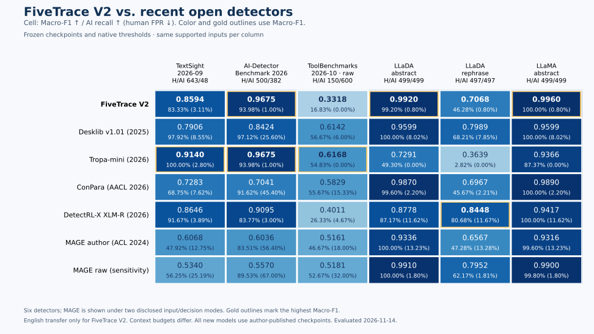
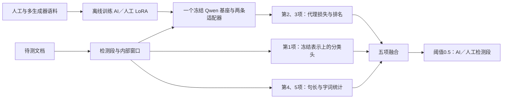

[English](README.md) | **简体中文**

# FiveTrace V2

### 五项证据 · 一个本地 Qwen · 检测时零目标模型 API 调用

[方法原理](docs/METHOD.md) · [近期对比](docs/RECENT_COMPARISON.md) · [完整结果](docs/RESULTS.md) · [评测协议](docs/PROTOCOL.md)


**学习生成器的文本语料，在本地完成检测。** FiveTrace V2 使用一个冻结的 Qwen3-1.7B-Base、AI／人工两条 LoRA 适配器、文本表示分类头，以及句长和字词统计。

在 **499 组同题的 LLaDA 生成摘要与人工摘要**上，冻结的 V2 在固定 0.5 阈值下取得 **0.9920 Macro-F1、99.20% AI 检出率、0.80% 人工误报率**。已核查的拟合清单没有该扩散生成器。这是一个具体外测条件的成绩，不代表所有任务的准确率或完整排行榜表现。

| 五项融合证据 | 1.7B 本地基座 | 零目标生成器 API 调用 |
|---|---|---|
| 表示分类 + 损失 + 排名 + 句长 + 字词统计 | 一个 Base + AI／人工 LoRA | 用语料扩展覆盖，检测时无需部署原模型 |

## 中文回归：7 个双类别条件全部高于官方 XLM-R

以下为 **5 个中文来源、7 个双类别条件**，比较对象是 **DetectRL-X 官方 XLM-R（2026）**。V2 在 XLM-R 的原文前 512 tokens 和统一全文两种策略下均取得更高 Macro-F1。前三行属于 V2 的训练同源留出；这是来源内／迁移回归比较，**不是 DetectRL-X 官方测试集排名**。混写／攻击条件单独标明，人工对照有复用。

每格第一行为 **Macro-F1 ↑**，第二行为 **AI 检出率 ↑（人工误报率 ↓）**。加粗仅标记该列最高 Macro-F1。

Macro-F1 是人工类与 AI 类 F1 的平均值。AI 检出率的分母是 AI 输入数；人工误报率的分母是人工输入数，表示其中被错判为 AI 的比例。

| 来源／条件 | 人工／AI | **FiveTrace V2** | XLM-R · 前512 tokens | XLM-R · 统一全文 |
|---|---:|---:|---:|---:|
| C-ReD · 同源留出 | 804/1099 | **0.9957**<br>99.55%（0.37%） | 0.9052<br>98.64%（19.40%） | 0.9052<br>98.64%（19.40%） |
| HC3 · 同源留出 | 382/382 | **0.9987**<br>100.00%（0.26%） | 0.7496<br>60.47%（9.42%） | 0.7496<br>60.47%（9.42%） |
| CUDRT · 同源留出 | 104/106 | **0.8158**<br>67.92%（3.85%） | 0.7164<br>55.66%（10.58%） | 0.7164<br>55.66%（10.58%） |
| M4 · 中文问答 | 100/200 | **0.9596**<br>95.00%（1.00%） | 0.6226<br>43.50%（0.00%） | 0.6052<br>41.00%（0.00%） |
| STORAL · 正常故事 | 100/100 | **1.0000**<br>100.00%（0.00%） | 0.8519<br>100.00%（29.00%） | 0.8519<br>100.00%（29.00%） |
| STORAL · 混写条件 | 100/100 | **0.9700**<br>94.00%（0.00%） | 0.7545<br>80.00%（29.00%） | 0.7789<br>85.00%（29.00%） |
| STORAL · 攻击／鲁棒条件 | 353/500 | **0.9844**<br>97.80%（0.57%） | 0.7956<br>83.40%（24.36%） | 0.7866<br>81.80%（24.36%） |

[误报率、检出率与完整来源说明](docs/RESULTS.md)。

## 再看两套标准 benchmark

在已有来源之外，新增 **COLING 2025 GenAI Task 1 正式英文测试集**和 **Intel AI Peer Review Detection Benchmark 的 ICLR2024 test**。先固定来源、抽样规则、模型和阈值，再做预测：分别抽取 **300 官方人工类（负类）＋300 官方机器类标签**、**50 篇论文对应的人工审稿＋5 个模型各 50 篇审稿**。这些是固定子集，**不代表完整官方排行榜分数**。

每格第一行为 **Macro-F1 ↑**，第二行为 **AI 检出率 ↑（人工误报率 ↓）**。加粗仅标记该列最高 Macro-F1。

| 检测器 | COLING 2025 · 正式测试子集 | Intel · 审稿测试子集 |
|---|---:|---:|
| **FiveTrace V2** | 0.8250<br>83.33%（18.33%） | 0.8969<br>95.20%（12.00%） |
| Desklib (2025) | 0.7274<br>85.67%（39.33%） | 0.7996<br>100.00%（52.00%） |
| Tropa-mini (2026) | **0.8367**<br>82.67%（15.33%） | **0.9324**<br>98.40%（14.00%） |
| ConPara (AACL 2026) | 0.8127<br>92.67%（29.67%） | 0.9187<br>98.40%（18.00%） |
| DetectRL-X XLM-R (2026) | 0.7647<br>60.00%（5.67%） | 0.6877<br>73.60%（14.00%） |
| MAGE author (ACL 2024) | 0.7409<br>79.67%（31.33%） | 0.7220<br>87.20%（38.00%） |

**COLING 标签口径补充（事后核查）：**300 条官方人工类（负类）中，75 条是 MixSet 的 `gpt4_humanize`／`2llama_humanize` 人化文本；[MixSet 作者](https://llm-coauthor.github.io/)将 humanize 描述为对机器文本的修改。因此该列“人工误报率”是**官方负类 FPR**，不能全部解释为纯人工写作的误伤率。此口径适用于所有检测器；600 条原标签、输入和已发布分数均保留。

**在这两套子集、各自预设工作点的 Macro-F1 上，V2 均高于 Desklib、官方 XLM-R 和 MAGE。** Tropa-mini 的点估计更高；V2 与 Tropa／ConPara 的成对差值区间均跨零，当前样本尚不能确定统计上的优劣。


各列取全部 6 个检测器共同支持的输入；Intel 按完整论文配对过滤。COLING 含混写、改写等官方任务，保留官方标签，并在[完整报告](docs/STANDARD_BENCHMARKS.md)按来源／任务、生成器列出结果。图中右侧两列是同一批文本的干净／零宽字符压力条件，**不额外计作独立 benchmark**。拟合／历史外测重合检查、来源熟悉度和局限均公开；没有使用新测试数据训练或调阈值。

## 与近期开放检测器实测对比

新增 **Desklib（2025）、Tropa-mini（2026）、DeBERTa-ConPara（AACL-IJCNLP 2026）**，均采用作者公开权重，三款模型各测满 **6,861 条合格公开英文输入**。与 DetectRL-X 官方 XLM-R、MAGE 一起，共比较 **6 个检测器**，各组取共同支持的输入；MAGE 作者流程有 6 条旧来源输入超出上下文限制。这轮对比没有重新训练 V2，也没有利用测试标签调阈值。



先看三个不同来源，人工／AI 数分别为 **643／48、500／382、150／600**。各模型在每列使用同一批输入，不能把各列当作同一分布的重复实验。

每格第一行为 **Macro-F1 ↑**，第二行为 **AI 检出率 ↑（人工误报率 ↓）**。加粗仅标记该列最高 Macro-F1。

| 检测器／发布年份 | TextSight | AI-Detector-Benchmark | ToolBenchmarks · 原始输出 |
|---|---:|---:|---:|
| **FiveTrace V2** | 0.8594<br>83.33%（3.11%） | **0.9675**<br>93.98%（1.00%） | 0.3318<br>16.83%（0.00%） |
| Desklib v1.01 · 2025 | 0.7906<br>97.92%（8.55%） | 0.8424<br>97.12%（25.60%） | 0.6142<br>56.67%（6.00%） |
| Tropa-mini · 2026 | **0.9140**<br>100.00%（2.80%） | **0.9675**<br>93.98%（1.00%） | **0.6168**<br>54.83%（0.00%） |
| DeBERTa-ConPara · AACL 2026 | 0.7283<br>68.75%（7.62%） | 0.7041<br>91.62%（45.40%） | 0.5829<br>55.67%（15.33%） |
| DetectRL-X XLM-R · 2026 | 0.8646<br>91.67%（3.89%） | 0.9095<br>83.77%（3.00%） | 0.4011<br>26.33%（4.67%） |
| MAGE · ACL 2024 · author | 0.6068<br>47.92%（12.75%） | 0.6036<br>83.51%（56.40%） | 0.5161<br>46.67%（18.00%） |
| MAGE · raw sensitivity† | 0.5340<br>56.25%（25.19%） | 0.5570<br>89.53%（67.00%） | 0.5181<br>52.67%（32.00%） |

下表沿用相同单元格格式，是**同一个学术摘要 benchmark 的三个条件**，不计作三个独立 benchmark。人工／AI 输入分别为 **499／499、497／497、499／499**；共用的人工对照不相加当作独立作者数。

| 检测器／发布年份 | LLaDA 摘要 | LLaDA 重述 | LLaMA 摘要 |
|---|---:|---:|---:|
| **FiveTrace V2** | **0.9920**<br>99.20%（0.80%） | 0.7068<br>46.28%（0.80%） | **0.9960**<br>100.00%（0.80%） |
| Desklib v1.01 · 2025 | 0.9599<br>100.00%（8.02%） | 0.7989<br>68.21%（7.85%） | 0.9599<br>100.00%（8.02%） |
| Tropa-mini · 2026 | 0.7291<br>49.30%（0.00%） | 0.3639<br>2.82%（0.00%） | 0.9366<br>87.37%（0.00%） |
| DeBERTa-ConPara · AACL 2026 | 0.9870<br>99.60%（2.20%） | 0.6967<br>45.67%（2.21%） | 0.9890<br>100.00%（2.20%） |
| DetectRL-X XLM-R · 2026 | 0.8778<br>87.17%（11.62%） | **0.8448**<br>80.68%（11.67%） | 0.9417<br>100.00%（11.62%） |
| MAGE · ACL 2024 · author | 0.9336<br>100.00%（13.23%） | 0.6567<br>47.28%（13.28%） | 0.9316<br>99.60%（13.23%） |
| MAGE · raw sensitivity† | 0.9910<br>100.00%（1.80%） | 0.7952<br>62.17%（1.81%） | 0.9900<br>99.80%（1.80%） |

† MAGE 原文前 4096 tokens、softmax 0.5 是**敏感性对照**，与作者部署流程属于同一个检测器；它的结果也完整保留。

**比较采用各自预设工作点，并非人为匹配误报率。** V2 为 0.5，Desklib 为 0.5，Tropa 为 0.975591，ConPara 使用检查点内保存的源验证集 logit 差阈值 2.942383；MAGE 作者流程另有原始 logit 边界。输入上下文预算也不同。[完整对照表](docs/RECENT_COMPARISON.md)同时列出实际误报率、检出率、AUROC、置信区间、长文处理和固定版本。新对照的完整训练暴露未知，不能据此宣称这些原文对所有模型都完全未见。

**中文仍是 V2 的主要训练语言，英文属于迁移评测。** 重述、短问答和新来源的困难结果保留在图表和完整报告中；本页不宣称完整排行榜上的普遍领先。

## 核心思路：用语料训练损失与排名代理

对于第 **2、3 项**，收集带标签的生成器输出和人工写作语料，在本地 Qwen 参考模型上训练两条类别适配器。检测时：

- **不需要原生成模型的权重。**
- **不调用 GPT、Claude 等原生成模型的推理 API。**
- 一个 Qwen 基座分别提供基础模型、AI 适配分支、人工适配分支的损失与 token 排名统计。
- AI 分支混合学习多个生成器的语料，人工分支学习人工文本；它们不是每个原生成模型分布的精确复刻。

这一设计减少了目标模型的部署依赖，避免检测每篇文档时支付目标 API 费用。本地仍需计算 **三组参考模型状态**，并处理长文本滑动上下文、完整词表排名、分词和融合。语料采集、适配器训练及本地推理均有成本；目前没有针对商业模型的同条件百分比加速或费用节省测量。



项目的设计重点是小型语料代理、AI／人工分支差值与五项融合。生成器覆盖由训练语料提供，实际部署的评分基座始终在本地。

## 更多来源上的迁移结果

其他来源的部分结果，V2 阈值均为 0.5：

| 来源／条件 | 人工／AI 输入数 | 人工误报率 | AI 检出率 |
|---|---:|---:|---:|
| C-ReD 已知来源留出 | 804 / 1099 | 0.37% | 99.55% |
| HC3 已知来源留出 | 382 / 382 | 0.26% | 100.00% |
| M4 中文问答 | 100 / 200 | 1.00% | 95.00% |
| STORAL 正常故事 | 100 / 100 | 0% | 100% |
| TextSight 英文 | 643 / 48 | 3.11% | 83.33% |
| ToolBenchmarks 英文 | 150 / 600 | 0% | **16.83%** |
| Data-Prep 英文问答 · 只有 AI | 0 / 1168 | — | **13.18%** |

保留最后两行，是因为短回答、事实型回答和新来源仍然较难检测。V2 **以中文为主**，英文结果属于实验性迁移，并非中英双语微调的成果。此前五轮 V3 的 DetectRL-X 成绩不属于 V2，本版本不引用该成绩作为宣传指标。

## 本地运行

仓库发布 **源码、文档和汇总结果**，不包含数据集、真实原文示例、逐条预测、缓存、适配器或基座权重。训练所需的公开上游资源会下载到 Git 忽略的本地运行目录。

```bash
python -m venv .venv
# 激活虚拟环境，并先安装适合本机 CUDA 的 PyTorch。
pip install -r requirements.txt
python prepare_sources.py
python train.py all
python detect.py your_document.txt --output local_report.json
python evaluate.py your_test.jsonl --output aggregate_metrics.json
python -m unittest discover -s tests -v
```

`evaluate.py` 读取本地 JSONL，每条记录需要 `text` 和整数 `label`（0 为人工，1 为 AI）。它只写出汇总指标，并单独统计不足 100 个非空白字符的输入，不上传正文。可通过 `--artifact-dir` 选择兼容的本地检测器，通过 `FIVETRACE_HOME` 指定模型、数据和训练产物的本地运行根目录。

**完整检测器并不是 16.2 分钟训练完的。** 这个数只加总 AI、人工两支 **LoRA 训练阶段**（含该阶段开发集评估）：476.6 + 495.1 秒。此前的分词／模型加载、特征提取、分类头／融合层拟合、下载和 benchmark 评测均未包含。**没有保留一次完整、连续流程的可靠总计时**；使用缓存的续跑耗时也不能充当完整训练耗时。

实测 LoRA 阶段使用 **RTX 5060 Laptop GPU（8 GB）**，每支适配器有 **1,605,632 个可训练参数**，每分支 **3,000 个训练单元、160 个开发单元，训练 1 轮**，该阶段峰值 CUDA 已分配显存约 **4.18 GiB**。第 1 项另用 **8,000 条带标签的冻结基座表示**训练逻辑回归分类头，融合层另用 **3,000 条**；准备了更多语料不等于全部参与拟合。详见[训练范围与资源记录](results/training.json)。

公开训练入口重放此前已选定的完整 V2 LoRA 架构及分类头／融合方案，按当前固定 0.5 阈值报告结果。它不重新进行架构搜索，也不执行 V3 的五轮训练方案。训练与测试隔离规则见[评测协议](docs/PROTOCOL.md)。

## 五项检测依据

| 项目 | 检测依据 | 实现 |
|---|---|---|
| 1 | 文本整体表示 | 冻结基座表示上的逻辑回归分类头 |
| 2 | 本地参考模型下的可预测性 | 基础／AI／人工分支的语言模型损失与分支差值 |
| 3 | 本地参考模型的 token 偏好 | 完整词表的精确 midrank 排名统计与分支差值 |
| 4 | 句子长度变化 | 均值、标准差及相关长度统计 |
| 5 | 字词使用规律 | 重复、分布及指代词统计 |

内部窗口先加权汇总为检测段分数。面向文章展示的 **AI 率＝判为 AI 的检测段数／总检测段数**，长段的内部窗口不额外投票。benchmark 的文档分数则使用按字符加权的分数均值。两者均不能证明作者身份或文章实际使用 AI 的程度。

## 适用范围与复现说明

- 外测前冻结模型与 0.5 阈值，不使用测试标签重新拟合或选择阈值。
- 拟合／开发文本家族检查排除了已知重合，但无法保证没有语义近重复或基座预训练接触；MAGE 的完整训练暴露也未核验。
- 历史测试来源已影响此前研究设计；新来源在结果公开后也成为已暴露的回归检查。
- 来源中的 LLaMA 重述文件存在编号错位，已从同题主比较排除，没有猜测重排。
- 混写、编辑、长上下文、短回答和新生成器均可能改变表现。加入新生成器语料后仍需重新训练与独立验证，不能保证任意未见生成器的检出效果。
- 已发布的置信区间和源家族计数见[汇总 JSON](results/external_v2.json)。复用的人工对照不能直接相加作为独立作者数。
- 项目没有实现遥测或上传；第三方依赖保留各自行为。详见[隐私与发布边界](docs/PRIVACY.md)。

## 致谢与许可

本项目代码采用 MIT 许可证；上游语料与模型保留各自许可证，仓库不重新分发这些数据或权重。

- [Qwen3-1.7B-Base](https://huggingface.co/Qwen/Qwen3-1.7B-Base)。
- [C-ReD](https://github.com/HeraldofLight/C-ReD)、[HC3-Chinese](https://huggingface.co/datasets/Hello-SimpleAI/HC3-Chinese)、[NLPCC/CUDRT](https://github.com/NLP2CT/NLPCC-2026-Task6-Detection)。
- [Can You Detect the Difference?](https://arxiv.org/abs/2507.10475) 与[额外扩散输出集](https://huggingface.co/datasets/paoche11/diffusion-generated-text)。
- [DetectRL-X 官方 XLM-R](https://huggingface.co/WUJUNCHAO/DetectRL-X-XLM-RoBERTa-Detector-All)、[MAGE](https://huggingface.co/yaful/MAGE) 及其[公开部署代码](https://github.com/yafuly/MAGE)。

使用本项目时，请同时引用相关上游来源。欢迎提供复现报告、改进和经过审慎设计的新领域评测。
