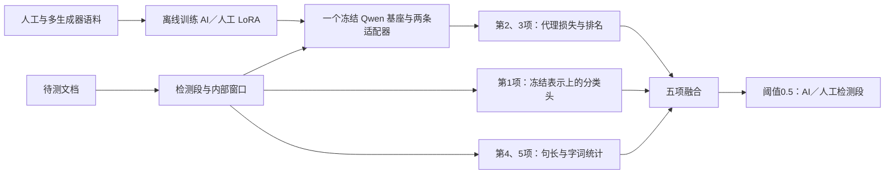

[English](README.md) | **简体中文**

# FiveTrace V2

### 用生成器语料训练，用一个本地 Qwen 基座检测。

[方法原理](docs/METHOD.md) · [完整结果](docs/RESULTS.md) · [评测协议](docs/PROTOCOL.md)


**学习生成器的文本语料，在本地完成检测。** FiveTrace V2 使用一个冻结的 Qwen3-1.7B-Base、AI／人工两条 LoRA 适配器、文本表示分类头，以及句长和字词统计。

在 **499 组同题的 LLaDA 生成摘要与人工摘要**上，冻结的 V2 在固定 0.5 阈值下取得 **0.9920 Macro-F1、99.20% AI 检出率、0.80% 人工误报率**。已核查的拟合清单没有该扩散生成器。这是一个具体外测条件的成绩，不代表所有任务的准确率或完整排行榜表现。

## 核心思路：用语料训练损失与排名代理

对于第 **2、3 项**，收集带标签的生成器输出和人工写作语料，在本地 Qwen 参考模型上训练两条类别适配器。检测时：

- **不需要原生成模型的权重。**
- **不调用 GPT、Claude 等原生成模型的推理 API。**
- 一个 Qwen 基座分别提供基础模型、AI 适配分支、人工适配分支的损失与 token 排名统计。
- AI 分支混合学习多个生成器的语料，人工分支学习人工文本；它们不是每个原生成模型分布的精确复刻。

这一设计减少了目标模型的部署依赖，避免检测每篇文档时支付目标 API 费用。本地仍需计算 **三组参考模型状态**，并处理长文本滑动上下文、完整词表排名、分词和融合。语料采集、适配器训练及本地推理均有成本；目前没有针对商业模型的同条件百分比加速或费用节省测量。



项目的设计重点是小型语料代理、AI／人工分支差值与五项融合。生成器覆盖由训练语料提供，实际部署的评分基座始终在本地。

## 外部测试结果

下表是各同题条件的 **Macro-F1**，越高越好。V2 始终采用同一套全文处理规则；XLM-R 的上下文限制和 MAGE 的作者部署流程已明确标记。统一全文对照及 MAGE 原文 raw 入口的结果也保留在[完整报告](docs/RESULTS.md)中。

| 同题条件 | 主题家族数 | **FiveTrace V2** | XLM-R · 原文前512 tokens | MAGE · 作者流程 |
|---|---:|---:|---:|---:|
| LLaDA 摘要生成 | 499 | **0.9920** | 0.8778 | 0.9336 |
| LLaDA 重述 | 497 | 0.7068 | **0.8448** | 0.6567 |
| LLaMA 摘要生成 | 499 | **0.9960** | 0.9417 | 0.9316 |

**不同任务上的表现有明显差异。** 摘要生成的较高成绩并没有消除重述任务的差距。额外的纯 AI 扩散输出集包含七个模型／长度层，V2 的检出率为 **47%–98%**；该集合没有人工对照，因此不计算误报率或二分类 F1。

其他来源的部分结果，V2 阈值均为 0.5：

| 来源／条件 | 人工／AI 输入数 | 人工误报率 | AI 检出率 |
|---|---:|---:|---:|
| C-ReD 已知来源留出 | 804 / 1099 | 0.37% | 99.55% |
| HC3 已知来源留出 | 382 / 382 | 0.26% | 100.00% |
| M4 中文问答 | 100 / 200 | 1.00% | 95.00% |
| STORAL 正常故事 | 100 / 100 | 0% | 100% |
| TextSight 英文 | 643 / 48 | 3.11% | 83.33% |
| ToolBenchmarks 英文 | 150 / 600 | 0% | **16.83%** |
| Data-Prep 英文问答 · 只有 AI | 0 / 1168 | — | **13.18%** |

保留最后两行，是因为短回答、事实型回答和新来源仍然较难检测。V2 **以中文为主**，英文结果属于实验性迁移，并非中英双语微调的成果。此前五轮 V3 的 DetectRL-X 成绩不属于 V2，本版本不引用该成绩作为宣传指标。

## 本地运行

仓库发布 **源码、文档和汇总结果**，不包含数据集、真实原文示例、逐条预测、缓存、适配器或基座权重。训练所需的公开上游资源会下载到 Git 忽略的本地运行目录。

```bash
python -m venv .venv
# 激活虚拟环境，并先安装适合本机 CUDA 的 PyTorch。
pip install -r requirements.txt
python prepare_sources.py
python train.py all
python detect.py your_document.txt --output local_report.json
python evaluate.py your_test.jsonl --output aggregate_metrics.json
python -m unittest discover -s tests -v
```

`evaluate.py` 读取本地 JSONL，每条记录需要 `text` 和整数 `label`（0 为人工，1 为 AI）。它只写出汇总指标，并单独统计不足 100 个非空白字符的输入，不上传正文。可通过 `--artifact-dir` 选择兼容的本地检测器，通过 `FIVETRACE_HOME` 指定模型、数据和训练产物的本地运行根目录。

**完整检测器并不是 16.2 分钟训练完的。** 这个数只加总 AI、人工两支 **LoRA 训练阶段**（含该阶段开发集评估）：476.6 + 495.1 秒。此前的分词／模型加载、特征提取、分类头／融合层拟合、下载和 benchmark 评测均未包含。**没有保留一次完整、连续流程的可靠总计时**；使用缓存的续跑耗时也不能充当完整训练耗时。

实测 LoRA 阶段使用 **RTX 5060 Laptop GPU（8 GB）**，每支适配器有 **1,605,632 个可训练参数**，每分支 **3,000 个训练单元、160 个开发单元，训练 1 轮**，该阶段峰值 CUDA 已分配显存约 **4.18 GiB**。第 1 项另用 **8,000 条带标签的冻结基座表示**训练逻辑回归分类头，融合层另用 **3,000 条**；准备了更多语料不等于全部参与拟合。详见[训练范围与资源记录](results/training.json)。

公开训练入口重放此前已选定的完整 V2 LoRA 架构及分类头／融合方案，按当前固定 0.5 阈值报告结果。它不重新进行架构搜索，也不执行 V3 的五轮训练方案。训练与测试隔离规则见[评测协议](docs/PROTOCOL.md)。

## 五项检测依据

| 项目 | 检测依据 | 实现 |
|---|---|---|
| 1 | 文本整体表示 | 冻结基座表示上的逻辑回归分类头 |
| 2 | 本地参考模型下的可预测性 | 基础／AI／人工分支的语言模型损失与分支差值 |
| 3 | 本地参考模型的 token 偏好 | 完整词表的精确 midrank 排名统计与分支差值 |
| 4 | 句子长度变化 | 均值、标准差及相关长度统计 |
| 5 | 字词使用规律 | 重复、分布及指代词统计 |

内部窗口先加权汇总为检测段分数。面向文章展示的 **AI 率＝判为 AI 的检测段数／总检测段数**，长段的内部窗口不额外投票。benchmark 的文档分数则使用按字符加权的分数均值。两者均不能证明作者身份或文章实际使用 AI 的程度。

## 适用范围与复现说明

- 外测前冻结模型与 0.5 阈值，不使用测试标签重新拟合或选择阈值。
- 拟合／开发文本家族检查排除了已知重合，但无法保证没有语义近重复或基座预训练接触；MAGE 的完整训练暴露也未核验。
- 历史测试来源已影响此前研究设计；新来源在结果公开后也成为已暴露的回归检查。
- 来源中的 LLaMA 重述文件存在编号错位，已从同题主比较排除，没有猜测重排。
- 混写、编辑、长上下文、短回答和新生成器均可能改变表现。加入新生成器语料后仍需重新训练与独立验证，不能保证任意未见生成器的检出效果。
- 已发布的置信区间和源家族计数见[汇总 JSON](results/external_v2.json)。复用的人工对照不能直接相加作为独立作者数。
- 项目没有实现遥测或上传；第三方依赖保留各自行为。详见[隐私与发布边界](docs/PRIVACY.md)。

## 致谢与许可

本项目代码采用 MIT 许可证；上游语料与模型保留各自许可证，仓库不重新分发这些数据或权重。

- [Qwen3-1.7B-Base](https://huggingface.co/Qwen/Qwen3-1.7B-Base)。
- [C-ReD](https://github.com/HeraldofLight/C-ReD)、[HC3-Chinese](https://huggingface.co/datasets/Hello-SimpleAI/HC3-Chinese)、[NLPCC/CUDRT](https://github.com/NLP2CT/NLPCC-2026-Task6-Detection)。
- [Can You Detect the Difference?](https://arxiv.org/abs/2507.10475) 与[额外扩散输出集](https://huggingface.co/datasets/paoche11/diffusion-generated-text)。
- [DetectRL-X 官方 XLM-R](https://huggingface.co/WUJUNCHAO/DetectRL-X-XLM-RoBERTa-Detector-All)、[MAGE](https://huggingface.co/yaful/MAGE) 及其[公开部署代码](https://github.com/yafuly/MAGE)。

使用本项目时，请同时引用相关上游来源。欢迎提供复现报告、改进和经过审慎设计的新领域评测。
