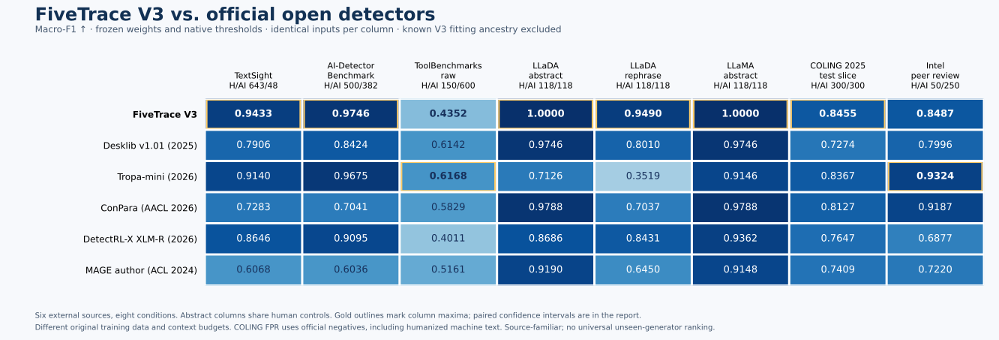

[English](README.md) | **简体中文**

# FiveTrace V3

### 看生成语料，在本地识别。检测时零目标模型 API 调用。

[Method](docs/METHOD.md) · [External comparison](docs/V3_EXTERNAL.md) · [Protocol](docs/PROTOCOL.md) · [Local training](docs/REPRODUCING_V3.md) · [V2 history](docs/V2_RELEASE.md)


**FiveTrace V3 把可训练的 mDeBERTa 文本分类器，与 Qwen 的 AI／人工语料代理损失、token 排名、句长和字词证据融合。** 无需部署被检测的 GPT、Claude 等原生成模型；本地部署一个 Qwen 基座、两条 LoRA，以及独立的 mDeBERTa 分类器。

在下述 **6 个外部来源、8 个条件**中，V3 在 **6/8** 个条件取得严格最高 Macro-F1 点估计。完整展示强项与弱项，并同时报告 AI 检出率和人工误报率；这不是统一训练数据或完整官方排行榜的比较。



**先排除训练重合，再统一输入比较。** 摘要条件各保留 118 对未匹配到 V3 训练／开发／校准同源组的文本；原始整套成绩单独保存为回归结果。其余五列沿用原冻结样本。V3 已学习相关来源与生成器，历史评测也影响过设计，因此不能称为完全盲测或未见生成器泛化。

每格为 **Macro-F1 ↑**，第二行为 **AI 检出率 ↑（人工误报率 ↓）**。加粗表示该列最高点估计。

| Detector | TextSight | AI-Detector-Benchmark | ToolBenchmarks raw | COLING 2025 test slice | Intel peer review |
|---|---:|---:|---:|---:|---:|
| **FiveTrace V3** | **0.9433**<br>97.92% (1.56%) | **0.9746**<br>96.34% (1.60%) | 0.4352<br>29.67% (0.67%) | **0.8455**<br>76.00% (6.67%) | 0.8487<br>92.80% (18.00%) |
| Desklib v1.01 (2025) | 0.7906<br>97.92% (8.55%) | 0.8424<br>97.12% (25.60%) | 0.6142<br>56.67% (6.00%) | 0.7274<br>85.67% (39.33%) | 0.7996<br>100.00% (52.00%) |
| Tropa-mini (2026) | 0.9140<br>100.00% (2.80%) | 0.9675<br>93.98% (1.00%) | **0.6168**<br>54.83% (0.00%) | 0.8367<br>82.67% (15.33%) | **0.9324**<br>98.40% (14.00%) |
| ConPara (AACL 2026) | 0.7283<br>68.75% (7.62%) | 0.7041<br>91.62% (45.40%) | 0.5829<br>55.67% (15.33%) | 0.8127<br>92.67% (29.67%) | 0.9187<br>98.40% (18.00%) |
| DetectRL-X XLM-R (2026) | 0.8646<br>91.67% (3.89%) | 0.9095<br>83.77% (3.00%) | 0.4011<br>26.33% (4.67%) | 0.7647<br>60.00% (5.67%) | 0.6877<br>73.60% (14.00%) |
| MAGE author (ACL 2024) | 0.6068<br>47.92% (12.75%) | 0.6036<br>83.51% (56.40%) | 0.5161<br>46.67% (18.00%) | 0.7409<br>79.67% (31.33%) | 0.7220<br>87.20% (38.00%) |


每格为 **Macro-F1 ↑**，第二行为 **AI 检出率 ↑（人工误报率 ↓）**。加粗表示该列最高点估计。

| Detector | LLaDA abstract | LLaDA rephrase | LLaMA abstract |
|---|---:|---:|---:|
| **FiveTrace V3** | **1.0000**<br>100.00% (0.00%) | **0.9490**<br>89.83% (0.00%) | **1.0000**<br>100.00% (0.00%) |
| Desklib v1.01 (2025) | 0.9746<br>100.00% (5.08%) | 0.8010<br>66.10% (5.08%) | 0.9746<br>100.00% (5.08%) |
| Tropa-mini (2026) | 0.7126<br>46.61% (0.00%) | 0.3519<br>1.69% (0.00%) | 0.9146<br>83.05% (0.00%) |
| ConPara (AACL 2026) | 0.9788<br>100.00% (4.24%) | 0.7037<br>48.31% (4.24%) | 0.9788<br>100.00% (4.24%) |
| DetectRL-X XLM-R (2026) | 0.8686<br>86.44% (12.71%) | 0.8431<br>81.36% (12.71%) | 0.9362<br>100.00% (12.71%) |
| MAGE author (ACL 2024) | 0.9190<br>100.00% (16.10%) | 0.6450<br>47.46% (16.10%) | 0.9148<br>99.15% (16.10%) |


| Condition | Human / AI |
|---|---:|
| TextSight | 643 / 48 |
| AI-Detector-Benchmark | 500 / 382 |
| ToolBenchmarks raw | 150 / 600 |
| LLaDA abstract | 118 / 118 |
| LLaDA rephrase | 118 / 118 |
| LLaMA abstract | 118 / 118 |
| COLING 2025 test slice | 300 / 300 |
| Intel peer review | 50 / 250 |

**比较边界：**所有模型权重与原生阈值固定；不使用外测标签调参。官方模型训练来源及上下文预算不同。三列摘要复用人工对照。COLING 原始 300 个官方负类中有 75 个经 humanize 改写的机器文本，因此其 FPR 表示官方负类误报率。

[完整成绩、AUROC、成对置信区间与训练重合统计](docs/V3_EXTERNAL.md)。表中最高点估计不自动代表统计显著优于其他方法。

## V3 相比 V2 改了什么

| Evidence | V3 implementation |
|---|---|
| 1 | Full-parameter mDeBERTa-v3-base fine-tuning; continuous AI-minus-human logit |
| 2 | Base / AI-LoRA / human-LoRA causal loss and branch differences |
| 3 | Exact full-vocabulary token midrank statistics and branch differences |
| 4 | Language-aware sentence-length statistics |
| 5 | Language-aware lexical/repetition/pronoun statistics and reliability inputs |

中英文参考适配器均重新训练。第 1 项、参考模型与融合层使用相互独立的训练来源组。文档检测使用中文字符／英文 token 窗口，内部窗口先汇总成段落。文章 AI 率仍是判为 AI 的检测段占比；benchmark 文档分数使用字符加权概率，两者口径不同。

## 单独报告：覆盖生成器的协议 A

这是另一个实验，不用于上图的官方权重排名。20,000 篇独立测试文档，人工／AI、中英文均衡，阈值 0.5：V3 的 Macro-F1 为 **99.45%**、AI 检出率 **99.72%**、人工误报率 **0.81%**；仅用同一个第一项分类器时分别为 98.42%、99.35%、2.50%。按生成器家族等权的 Macro-F1 为 95.69%，GLM 小样本等条件仍有明显弱项。协议 B 尚未评测。此处使用修正后的 FP32 分类器推理，原始训练权重、融合层和阈值未变。

[协议 A 汇总](results/v3_protocol_a.json) · [训练范围与阶段计时](results/v3_training.json)

## 本地使用

本次发布的是**源码与汇总结果，不含训练权重或数据集**。需要用自己的、经过校验的本地语料训练，或提供兼容的本地 V3 训练产物；仓库不是下载即用的预训练检测器。

```bash
pip install -r requirements.txt
python prepare_sources.py --models-only
python prepare_v3_data.py --train local/train.jsonl --development local/dev.jsonl --calibration local/calibration.jsonl --test local/test.jsonl
python train_v3.py all
python detect.py local/article.txt --output local/report.json
python evaluate.py local/test.jsonl --output local/aggregates.json
python -m unittest discover -s tests -v
```

先安装适合本机 CUDA 的 PyTorch。具体字段、来源分组和训练阶段见[训练说明](docs/REPRODUCING_V3.md)。可用 `FIVETRACE_HOME` 指定本地运行目录。V3 需要 CUDA；计算 Qwen 排名时把分类器移回 CPU。训练与特征计算曾在 8 GB RTX 5060 Laptop 上完成，但不保证所有硬件、输入长度与批量配置均适用。

`train.py` 保留为明确标注的 V2 旧训练入口；用 `--artifact-dir` 指定兼容 V2 产物可运行旧版。[V2 文档](docs/V2_RELEASE.md)保留原测量结果。


## 适用边界

检测分数是模型判断，不是作者身份或实际 AI 使用比例的证明。人工误报不可忽视，尤其是学术文本、短文和新领域。第 2、3 项是本地语料代理的分布测量，不是原生成模型的真实概率；代表性语料会影响覆盖。没有测量相对目标模型的同条件百分比提速或费用节省。

引用本项目时，请同时引用相关模型、检测器与数据来源，详见完整报告和 V2 历史文档。
